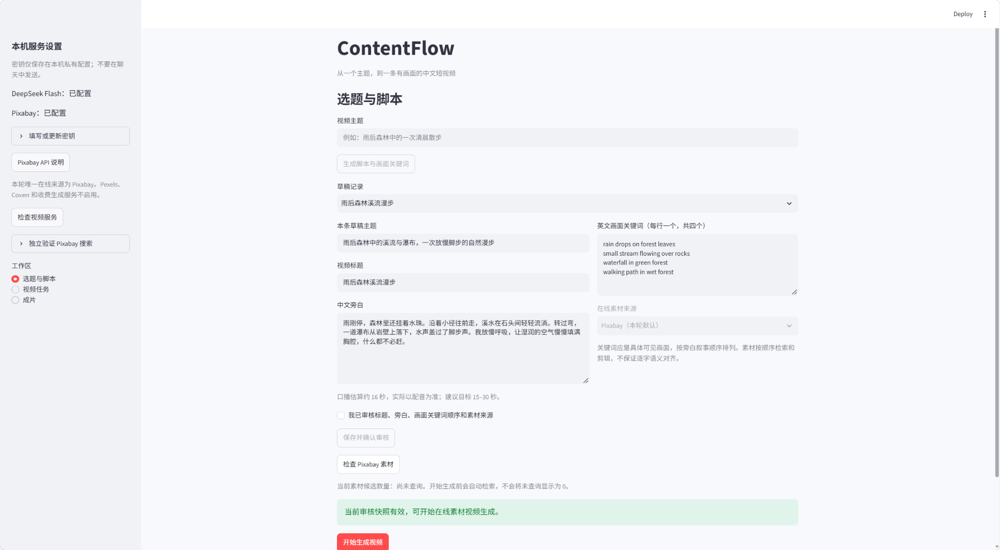
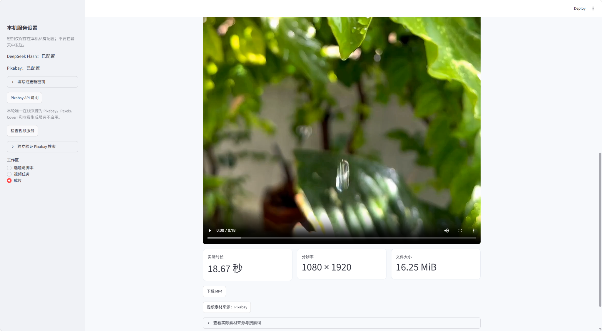

# ContentFlow

输入主题，用 DeepSeek Flash 生成标题、中文旁白和四个有序英文画面关键词，人工审核后由本机 MoneyPrinterTurbo 从 Pixabay 搜索素材并生成视频。2026-11-01 起 Pixabay 是本轮唯一在线源。

项目源码：[Komatsu-Nana-CPU/ContentFlow](https://github.com/Komatsu-Nana-CPU/ContentFlow)。这是本机运行的课程MVP，GitHub仅托管源码和文档，**没有部署公开在线应用**。项目自身许可证选择仍为待办，第三方许可独立保留。

仅在你的电脑启动后可访问网页：[http://127.0.0.1:8501](http://127.0.0.1:8501)。本机视频后端：[http://127.0.0.1:8080/docs](http://127.0.0.1:8080/docs)。这些localhost地址不是在线演示链接；需要分别启动两个服务，不是开机自启。

**首条 Pixabay 真实在线成片已生成并下载：18.67 秒、1080×1920，含中文配音和烧录字幕。** 用户已审核本条稿件，随后在报告整理时补充确认已在浏览器完整观看、试听并点击下载，整体可行，接受末段画面偏差。该反馈按2026-11-02后续人工证据补记，观看发生于11月1日凌晨成片完成后，不改写当时工具未能播放的历史。详见 [验收补记](docs/验证与人工验收.md)、[真实联调报告](docs/第006轮Pixabay真实联调报告_公开版.md) 和 [开发记录](docs/AI辅助开发过程记录.md)。

技术检查包括全片解码、非静音、下载一致性和真实数据网页渲染。末段素材为夕阳步道，与湿润森林有偏差；用户接受该演示样片，不代表语义偏差已修复。第二主题尚未运行，完整AI会话仍待脱敏归档。

## 真实界面与演示

以下为本机已保存、经本轮查看的真实网页截图；只显示凭证“已配置”，密钥输入框折叠，无密钥明文。不是本轮新生成视频或新拍的操作过程。





**演示视频：待补充公开链接。** 当前没有已发布视频URL，不用失效占位链接。公开Git仓库不携带媒体；旧机器成片在 `runtime/contentflow/videos/045395ae-0ddd-48a1-8aaa-95db07c3970c.mp4`，新电脑没有该文件。运行后在“成片”页查看自己的生成结果；不要通过公开仓库相对链接查找被忽略的旧运行文件。

## 使用流程

1. 打开网页，在左侧“填写或更新密钥”中用密码输入框填写已有 DeepSeek Key 和 Pixabay Key；留空保留原值。不要把密钥发送到聊天。
2. 素材 Key 保存后需要重启 MoneyPrinterTurbo 才能使运行中配置生效；通知开发助手处理。DeepSeek 由 ContentFlow 每次请求前读取私有配置。
3. 输入主题，点击“生成脚本与画面关键词”。每次点击只调用一次 deepseek-flash，最多输出 1200 tokens，不自动重试。
4. 编辑标题、旁白及四个英文关键词，确认顺序和来源，勾选审核并点击“保存并确认审核”。编辑后审核自动失效。
5. 可先“检查 Pixabay 素材”查看每词候选数；点击“开始生成视频”也会自动检查，仅有可用素材才创建任务。仅允许一个活动任务；刷新不会重新提交。
6. 成片自动下载到本机；在任务或成片页预览/下载，并查看时长、分辨率、大小和可用的原始素材页。

本轮只使用 Pixabay，不启用 Pexels、Coverr 或收费生成；本地 MP4 保留在测试和故障备用层，不是网页默认输入。Pixabay 结果必须通过 1.3.6 的竖屏、宽度至少 1080、最小时长筛选，原始搜索结果和可用候选数量不同。

## 本机凭证与 Pixabay 检查

凭证文件为所配置 MoneyPrinterTurbo 目录中的config.toml，字段为 [app].pixabay_api_keys（字符串数组）；已有模型Key复用 [app].deepseek_api_key，模型保留deepseek-flash。也可使用网页密码框，用户只需填写凭证，不编写程序。机器路径通过配置工具设置，见下一节。

[Pixabay API 官方文档](https://pixabay.com/api/docs/)要求缓存、遵守频率和来源展示。网页成功/有效空结果缓存 24 小时，上游复用其搜索缓存；失败冷却 30 秒，不自动循环请求。最多四个画面关键词，不批量下载无关视频。

保存按钮只修改本机 MPT config.toml 指定 Key 字段，不改源码。不会自动加载 .env，不把 Key 存 SQLite、报告或日志。Pixabay 请求使用含 Key 的查询参数，探测器不回显 URL、请求头、响应正文或原始异常，只记录安全状态码和计数。

## 启动与依赖

首次使用请完整阅读 [Windows新电脑安装与启动](docs/新电脑安装与启动.md)：含Python/Git准备、固定SHA获取、独立uv/bootstrap、两套虚拟环境、私密配置、字体/FFmpeg、两终端启动、排错和回退。本轮没有在全新电脑重装，不将说明当作新机验收结果。

ContentFlow 与 MPT 使用不同虚拟环境。两环境已准备好后，在项目根目录运行：

```powershell
.\.venv\Scripts\python.exe -m streamlit run app.py
```

默认仅监听 127.0.0.1:8501。若后端需要重启，先核对没有活动任务，再在其独立目录运行：

```powershell
Set-Location D:\Projects\MoneyPrinterTurbo
& .\.venv\Scripts\python.exe main.py
```

机器相关路径由Agent通过下列工具配置；路径按本机实际位置替换：

```powershell
& .\.venv\Scripts\python.exe -B scripts/configure_local.py --mpt-dir D:/Projects/MoneyPrinterTurbo --font-path C:/Windows/Fonts/msyhbd.ttc
```

配置写入被忽略的config.local.json；默认MPT目录为ContentFlow同级MoneyPrinterTurbo，支持CONTENTFLOW_MPT_DIR、CONTENTFLOW_FONT_PATH、CONTENTFLOW_FFMPEG_PATH覆盖。FFmpeg优先显式配置/上游配置，否则查上游独立环境内捆绑二进制。详情见安装说明。requirements.txt是直接依赖，requirements.lock.txt是已验证环境精确版本，未含包哈希。

MPT 固定 1.3.6，源码不变；Edge TTS 7.3.1 为第五轮批准的独立覆盖，原锁为 7.2.7。不能仅运行 uv sync --frozen 后就声称复现成功环境；见 [依赖例外记录](docs/evidence/round005_dependency_override.json)。中文字体使用当前机器 C:/Windows/Fonts/msyhbd.ttc，换机器须重新核验字体。

## 检查与测试

```powershell
.\.venv\Scripts\python.exe -B -m unittest discover -s tests -v
.\.venv\Scripts\python.exe -B scripts/check_mpt_api.py --base-url http://127.0.0.1:8080
& D:\Projects\MoneyPrinterTurbo\.venv\Scripts\python.exe -B scripts/test_mpt_material_contract.py
```

第三条在上游专用环境模拟 HTTP，保留历史测试并覆盖 Pixabay 参数、无结果、超时、权限/限流、非 JSON、竖屏筛选与探测器秘密隔离，**不是真实素材检索**。

密钥配置好后，通过实际上游素材下载函数检查一条免费素材，既不调用 LLM，也不创建视频：

```powershell
& D:\Projects\MoneyPrinterTurbo\.venv\Scripts\python.exe -B scripts/probe_pixabay.py --mpt-dir D:/Projects/MoneyPrinterTurbo --terms-file docs/evidence/round006_pixabay_terms.json --download-one --output runtime/pixabay_probe_new.json
```

这条明确检查 waterfall，并最多下载一段；不调用 LLM 或创建视频。缺 Key 停止，不发无凭证请求。网页侧栏也能独立验证搜索；没有其他在线源或自动回退。

## 数据与故障处理

runtime/contentflow/contentflow.sqlite3持久保存草稿和任务；视频位于其videos子目录。提交结果不确定时禁止自动再发，须核对并绑定已有ID；后端重启查不到任务也进入需核对。目录权限、磁盘空间或文件占用引起保存OSError时，任务会保存为download_failed、保留task_id并显示可操作错误；修复后“重试下载”只GET原任务，不重新提交视频。临时文件采用同目录原子替换，保存失败保留已有MP4；数据库自身不可写不在这一恢复保证内。

审核确认后才能提交；不允许以模拟结果导入成功任务骗过验收。配音与素材网络失败不自动接入其他服务。上游素材异常有时仅返回空列表，应用只报告素材阶段失败和可能原因，不伪造精确 HTTP 原因。

数据库、私有配置、日志、媒体和 .venv 均被 Git 忽略；最终课程报告必须另外附带真实 MP4 和证据。当前无 Git 提交/远程推送。

ContentFlow复用MoneyPrinterTurbo的REST与媒体执行能力；原部署为固定提交API子集。开源引擎、许可及本项目实现边界见 [公开发布与复用说明](docs/公开发布与复用说明.md) 和 [第三方声明](THIRD_PARTY_NOTICES.md)。公开逐文件范围见 [公开文件清单](docs/公开文件清单.txt)。含个人信息的课程报告、未审查会话截图、凭证、环境、数据库、日志、原始素材和成片均留在本机，不上传。详见 [需求v0.4](docs/需求分析与技术可行性评估.md)、[集成说明](docs/MoneyPrinterTurbo_API集成说明.md) 与 [首次发布记录](docs/首次GitHub发布记录.md)。
