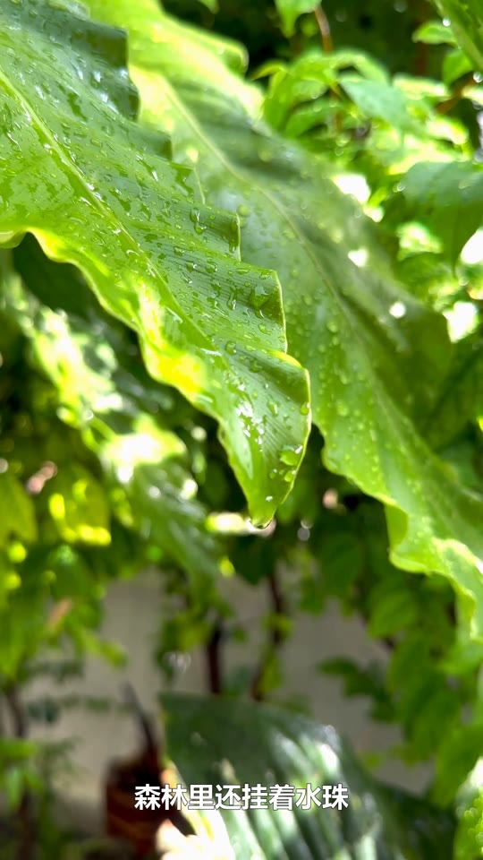
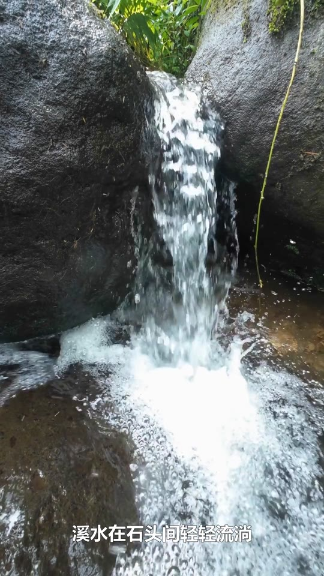
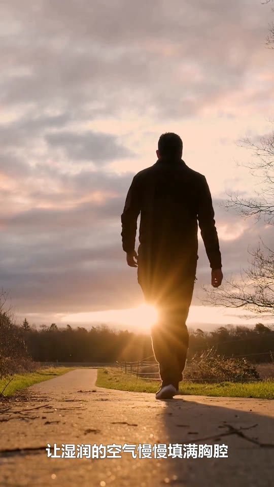

> 2026-11-04公开副本：原技术报告原件保留且未修改。本副本只将被忽略运行媒体/原始素材帧链接改为本机路径说明；历史未验收状态不回写。后续人工反馈见[验收补记](验证与人工验收.md)。

# 第 006 轮：Pixabay 真实联调结果

日期：2026-11-01（Asia/Shanghai）。范围：已有本机凭证、一次 Flash 结构化生成、人工审核、Pixabay 在线检索与素材下载、唯一 MPT 真实任务、成片下载和技术/UI渲染验证。

## 1. 已完成结果与边界

首条真实在线成片已从 ContentFlow 核心工作流生成并下载，数据已写入生产 SQLite。查看 [本机网页](http://127.0.0.1:8501) 的“成片”页，或打开 MP4 文件（仅本机保留，不随仓库分发；原记录路径：`../runtime/contentflow/videos/045395ae-0ddd-48a1-8aaa-95db07c3970c.mp4`）。没有上传本地素材替代 Pixabay。

| 项目 | 实际结果 |
| --- | --- |
| 标题 | 雨后森林溪流漫步 |
| MPT | 1.3.6，固定源码/锁文件；沿用批准的 Edge 7.3.1 覆盖 |
| 上游 task_id | 045395ae-0ddd-48a1-8aaa-95db07c3970c |
| ContentFlow job_id | 98c1b665-7571-4f16-9bf7-072fd9eb3519 |
| 状态 | complete；上游成功，进度100，无报告失败 |
| 时长 | 18.67 秒，目标15–30秒内 |
| 视频 | 1080×1920，9:16，30fps，H.264，560帧全片解码通过 |
| 音轨 | AAC，全片可解码且非静音；Edge 中文配音 |
| 字幕 | 10段中文烧录字幕；实际帧中可见，无目视乱码 |
| 字节大小 | 17,043,531，约16.25MiB |
| SHA-256 | 69f5d7c817bce7ecaada063f19ceb39fa1bcaa6161eadf3045b405bf247eebea |
| 实际素材 | 4个Pixabay视频，按四词顺序使用；来源已保存 |
| 调用限制 | 1次Flash、1次视频POST；没有Pro、充值、新收费服务或账号发布 |

**尚未完成：** 自动化工具无法可靠确定浏览器URL，按工具停止要求结束所有电脑交互；因此没有实际浏览器播放截图或主观试听通过。真实数据已在 Streamlit AppTest 中渲染出播放器、下载按钮和规格，但这不等于浏览器播放。第二主题未运行（当前是建议项）。不能将以上剩余项写成全部验收通过。

## 2. 凭证与首次真实素材验证

用户通过私下本机配置保存 Pixabay 和已有 DeepSeek Key，随后明确回复“已保存到本机配置”。只检查存在性，均为true；Edge字幕开启、自动发布关闭。确认无活动上游任务后重启main.py读取新设置。未把任何Key写入聊天、代码、报告或Git。

固定关键词 waterfall，一次真实HTTP200返回50项，经原1.3.6竖屏/宽度/时长规则剩13项。通过上游save_video下载一段MP4并解码首帧：2160×3840、60fps、20.4秒、211,672,535字节（约202MiB）。这说明默认候选可能很大，不能把API候选计数等同于轻量文件；本轮没有批量下载无关素材。[真实搜索/单条下载证据](evidence/round006_pixabay_validation.json)

原素材公开页：https://pixabay.com/videos/id-228847/ 。实际下载帧（仅本机保留，不随仓库分发；原记录路径：`evidence/round006_pixabay_source_frame.png`）可见树林和瀑布，非测试色块；此素材仅用于先行链路验证，不冒充最终4段的全部来源。

## 3. 单次 Flash、修订与人工批准

主题：雨后森林中的溪流与瀑布，一次放慢脚步的自然漫步。

实际模型 deepseek-flash，thinking disabled，max_tokens=1200；只请求一次。输入210、输出99、总309 tokens，消耗现有余额，实际货币扣费未查询，不声称免费或已核对余额。[原始结构化结果](evidence/round006_real_draft.json)

原稿“我停下呼吸”经非计费文字修订为“我放慢呼吸”；原响应保留。提交给用户审核的完整文案为：

> 雨刚停，森林里还挂着水珠。沿着小径往前走，溪水在石头间轻轻流淌。转过弯，一道瀑布从岩壁上落下，水声盖过了脚步声。我放慢呼吸，让湿润的空气慢慢填满胸腔，什么都不必赶。

有序关键词：

1. rain drops on forest leaves
2. small stream flowing over rocks
3. waterfall in green forest
4. walking path in wet forest

四词分别4/5/7/5个可用候选，去重20个，共4次HTTP200。原始结果各50项，均明确区分于可用候选数。[预检](evidence/round006_real_terms.json)

用户在完整文本交互审核请求后明确回复 **“确认这份稿件和关键词，生成视频”**，随后才保存审核指纹并提交。未点击用户未授权的审核按钮。[审核内容](evidence/round006_review_request.json)、[审批依据/提交及进度](evidence/round006_real_video.json)

## 4. 实际视频任务及上游复用

ContentFlow Workflow使用真实生产草稿与审核指纹，POST前查询素材并命中已有缓存；请求source=pixabay、已审核非空script和完整video_terms、match_materials_to_script=true、sequential、9:16、Edge中文音色、字幕开启、系统微软雅黑、无配乐。actual请求字段已从上游script.json按白名单提取：[服务端请求快照](evidence/round006_real_video_request.json)。

唯一POST后立即存储task_id；轮询仅查询同一任务。进度经历5/20/40/50/75，约00:33:40至00:36:54观测成功并下载，含轮询及解码开销，约3分14秒；不作为性能保证。背景任务没有因等待/超时被重复提交。

成功成片与上游final-1.mp4哈希相同；Range预览HTTP206返回1024字节，匹配文件前缀。上游保存的script/terms与审核内容完全一致，专用日志中“llm provider:”标记为0；结合非空参数分支，未发现视频任务重复调用LLM的证据。没有输出原始日志内容。[全片技术验证](evidence/round006_real_video_validation.json)

## 5. 来源与画面匹配检查

| 顺序/关键词 | 公开素材页 | 作者 |
| --- | --- | --- |
| rain drops on forest leaves | https://pixabay.com/videos/id-172759/ | TravelGardenB |
| small stream flowing over rocks | https://pixabay.com/videos/id-323176/ | hijef |
| waterfall in green forest | https://pixabay.com/videos/id-267095/ | Engin_Akyurt |
| walking path in wet forest | https://pixabay.com/videos/id-202753/ | Matthias_Groeneveld |

已保存公开来源和作者，未保存带鉴权参数的下载URL。API缓存和频率规则见 [Pixabay 官方文档](https://pixabay.com/api/docs/)。本轮实际搜索为1次先行测试+4次词序检索，视频执行复用缓存，不主动重复搜索或爬取大量素材。

从真实成片提取1.5/6.5/11.5/16.5秒画面检查：前段叶片水珠、石间流水和苔藓水景与自然主题相关；**末段是夕阳步道人物，不是湿润森林**，语义匹配有偏差。部分小水流与“大瀑布/岩壁”的尺度也不完全一致。字幕清晰，但词序匹配不保证逐句精确对齐；不能宣称四段全部精准匹配。后续可由用户修订关键词并重新审核做针对性改进，不自动再生成。

这些是实际成片解码帧，不是浏览器截图或模拟界面。

## 6. 音频验证器误判与界面验证

一次临时技术检查失败：MoviePy的抽样to_soundarray返回常量，RMS约0.000336，因此断言未通过。没有据此重发任务。独立FFmpeg volumedetect显示成片平均-22.5dB、峰值-6.6dB，原配音平均-19.5dB、峰值-3.6dB；音轨并非静音。[诊断](evidence/round006_audio_diagnostic.json)

随后仅修正临时验证器，使用FFmpeg完整解码float32 PCM：单声道RMS约0.1056、峰值约0.6628，完整音频样本/视频帧检查通过。未修改MPT源码、播放器或生产合成流程。系统已有中文离线识别能识别部分旁白，但有误字且置信度约0.26–0.46，不作为主观听感结论：[辅助ASR](evidence/round006_real_audio_asr.json)。

Streamlit AppTest直接读取**真实生产SQLite和真实17MB成片**，没有mock模型/API/媒体、没有点击按钮：1个视频播放器、1个下载控件，正确显示18.67秒、1080×1920、16.25MiB，零界面异常。[真实数据渲染](evidence/round006_real_ui_render.json)。这与此前模拟完整界面测试分开，仍不替代真实浏览器播放。

浏览器host不可用；恢复现有Chrome后，工具因无法可靠确定URL而停止本轮电脑操作。此后没有再操作浏览器、系统播放器或用其他UI自动化绕过。请用户在网页“成片”页完整观看试听后给出验收反馈。

## 7. 结论与剩余项

真实主题→Flash→人工批准→Pixabay搜索/下载→MPT生成→ContentFlow下载/持久化链路已通过，中文烧录字幕与音轨技术检查通过。程序已实际输出真实在线素材短片，未切换本地默认或收费生成服务。

仍需实际网页播放、下载按钮交互和主观试听/观看确认；末段素材相关性需要改进；第二主题建议复验但未运行。完整人工验收未关闭。没有Git提交/推送；密钥、数据库、日志和视频仍被忽略，课程交付须另附真实MP4。

[实时阶段摘要](evidence/round006_real_progress.json)、[AI开发过程记录](AI辅助开发过程记录.md)。

最终只读核验：网页健康、上游state=1/progress=100、生产任务complete；53项源码和uv.lock保持原样。11份Markdown本地链接通过，有限凭证模式检查无命中；数据库/视频/私有配置/虚拟环境均被忽略。1张4K源素材帧PNG超过1MiB，仍为未暂存证据；没有Git提交、暂存或远程。见 [最终检查](evidence/round006_real_final_checks.json)。
